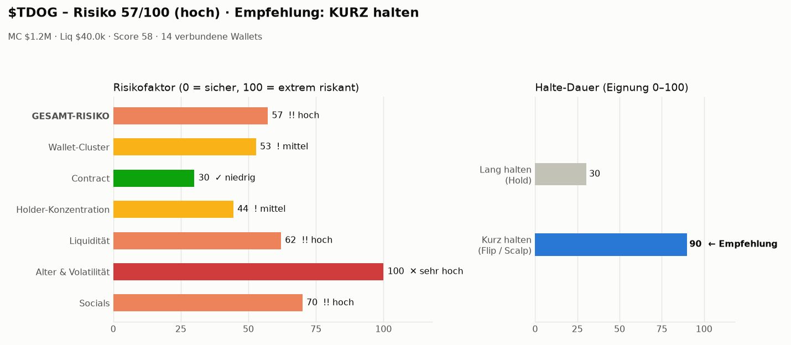

# Solana Memecoin Callout Bot

Findet neue Solana-Memecoins, prüft Social-Media-Kanäle, Contract und **Bubblemaps V2**
(wie viele Top-Holder-Wallets miteinander verbunden sind), erstellt Balkendiagramme zu
**Risiko** und **Halte-Dauer (lang/kurz)** und schickt gute Coins als Callout aufs Handy.
Dazu trackt er die Wallets großer und kleiner Memecoin-Trader.

> ⚠️ Keine Finanzberatung. Memecoins sind extrem riskant – der Score senkt das Risiko,
> eliminiert es aber nicht. Nur Geld einsetzen, dessen Verlust du verkraftest.

## So funktioniert's

```
DexScreener (neue Profile/Boosts) ─┐
Getrackte Wallets kaufen denselben ├─► Kandidaten ─► Filter Liquidität ─► Analyse ─► Score ─► Callout
Coin (≥ 2 Wallets in 6h)          ─┘                                     │
                                       Bubblemaps V2 (Cluster) ──────────┤
                                       Contract (Mint/Freeze, RugCheck) ─┤
                                       Socials (X, Telegram, Website) ───┤
                                       Markt (MC, Liq, Volumen, Alter) ──┘
```

**Risikofaktoren** (0 = sicher … 100 = extrem riskant, gewichtet zum Gesamt-Risiko):

| Faktor | Gewicht | Was geprüft wird |
|---|---|---|
| Wallet-Cluster | 25 % | Bubblemaps V2: verbundene Wallets, Supply-Anteil der Cluster, Decentralization Score |
| Contract | 20 % | Mint-/Freeze-Authority (RPC), RugCheck-Risiken, LP-Lock |
| Holder-Konzentration | 15 % | Anteil der Top-10-Holder (ohne Pools/CEX/Contracts) |
| Liquidität | 15 % | absolute Liquidität und Verhältnis zur Market Cap |
| Alter & Volatilität | 15 % | Alter des Pools, 1h-Preisbewegung, Verkaufsdruck |
| Socials | 10 % | X-Account (+Follower), Telegram (+Mitglieder), erreichbare Website |

**Halte-Empfehlung:** *Lang halten* profitiert von niedrigem Risiko, starken Socials, Alter,
dezentraler Verteilung und Whale-Käufen. *Kurz halten (Flip)* profitiert von Momentum,
hohem Umsatz relativ zur Liquidität, jungem Alter, Kaufdruck und Käufen kleiner Trader.

Ein **Callout** wird gesendet, wenn: Risiko ≤ `MAX_RISK`, Score ≥ `MIN_SCORE`, Liquidität ≥
`MIN_LIQUIDITY_USD` und **weder Mint- noch Freeze-Authority** aktiv ist. Jeder Coin wird
höchstens einmal pro `ALERT_COOLDOWN_HOURS` gemeldet.

Jeder Callout enthält ein Bild mit beiden Balkendiagrammen:



## Installation

```bash
python3 -m venv .venv && source .venv/bin/activate
pip install -r requirements.txt
cp .env.example .env              # dann .env ausfüllen (siehe unten)
cp wallets.example.json wallets.json
```

### API-Keys & Handy-Benachrichtigung

| Was | Wofür | Woher |
|---|---|---|
| `SOLANA_RPC_URL` | Wallet-Tracking, Contract-Check | z.B. kostenloser Key bei helius.dev |
| `BUBBLEMAPS_API_KEY` | verbundene Wallets (Bubblemaps V2) | bei Bubblemaps API-Zugang beantragen |
| `X_BEARER_TOKEN` (optional) | Follower-Zahlen | developer.x.com |
| `TWILIO_*` + `ALERT_PHONE_NUMBER` | **SMS** an deine Nummer | twilio.com (Nummer kaufen; im Trial-Account deine Handynummer verifizieren) |
| `TELEGRAM_*` (empfohlen) | Push **mit Diagramm-Bild** | Bot bei @BotFather anlegen, Chat-ID über @userinfobot |
| `NTFY_TOPIC` (kostenlos) | Push-Nachricht **mit Diagramm** | App „ntfy“ installieren, gleiches Topic abonnieren |

Trage deine Handynummer im internationalen Format in `.env` ein (`ALERT_PHONE_NUMBER=+43…`).
Die `.env` wird nicht ins Git-Repo eingecheckt. SMS werden nur für Coin-Callouts verschickt;
Whale-Trades kommen über Telegram/ntfy, damit keine SMS-Kosten explodieren.

Ohne Bubblemaps-Key läuft der Bot weiter, berechnet aber nur die Holder-Konzentration per RPC;
der Faktor *Wallet-Cluster* steht dann pauschal auf 60 (unbekannt = riskant).

## Benutzung

```bash
python -m memebot test-notify             # prüft SMS/Telegram/ntfy
python -m memebot analyze <TOKEN_CA>      # einzelnen Coin analysieren, Diagramm in charts/
python -m memebot analyze <TOKEN_CA> --notify
python -m memebot scan                    # einmal scannen
python -m memebot run                     # Dauerbetrieb: Scan + Wallet-Tracking
```

### Wallet-Tracking (große & kleine Trader)

```bash
python -m memebot wallets add <ADRESSE> --label whale-1 --category gross
python -m memebot wallets add <ADRESSE> --label degen-1 --category klein
python -m memebot wallets discover <TOKEN_CA>   # Top-Holder eines Coins übernehmen (gross ab WHALE_USD_THRESHOLD)
python -m memebot wallets list
python -m memebot wallets poll                  # neue Trades laden
python -m memebot wallets report                # letzte Trades + Coins, die mehrere Wallets kaufen
```

Was das Tracking macht:

- Käufe/Verkäufe werden aus den Token-Salden jeder Transaktion erkannt (Jupiter, Raydium,
  Pump.fun, Meteora … ohne DEX-spezifischen Code), inklusive eingesetzter SOL.
- **Whale-Alert** (Telegram/ntfy), wenn eine `gross`-Wallet ≥ `WALLET_ALERT_MIN_SOL` SOL bewegt.
- Coins, die **≥ 2 getrackte Wallets** innerhalb von 6h kaufen, werden automatisch analysiert.
- Käufe getrackter Wallets fließen in den Score ein (Whales → *lang*, kleine Trader → *kurz*).

### Dauerbetrieb

Auf einem Server/VPS z.B. mit `tmux` oder als systemd-Service:

```ini
[Service]
WorkingDirectory=/opt/bot
ExecStart=/opt/bot/.venv/bin/python -m memebot run
Restart=always
```

## Tests

```bash
python -m pytest -q
```

## Projektstruktur

```
memebot/
  __main__.py        Kommandozeile
  bot.py             Scan-Loop, Callouts, Whale-Alerts
  scoring.py         Risikofaktoren, Halte-Empfehlung, Callout-Entscheidung
  charts.py          Balkendiagramme (Risiko + lang/kurz)
  notify.py          SMS (Twilio), Telegram, ntfy
  wallets.py         Wallet-Tracker
  storage.py         SQLite (Alerts, Trades)
  sources/
    dexscreener.py   Discovery + Marktdaten + Social-Links
    bubblemaps.py    Bubblemaps V2 Cluster / verbundene Wallets
    rugcheck.py      Mint-/Freeze-Authority + RugCheck
    socials.py       X, Telegram, Website
    solana_rpc.py    Solana JSON-RPC
```

Alle Schwellen sind Startwerte – beobachte die Callouts ein paar Tage und passe `MAX_RISK`,
`MIN_SCORE` und `MIN_LIQUIDITY_USD` an deinen Stil an.
